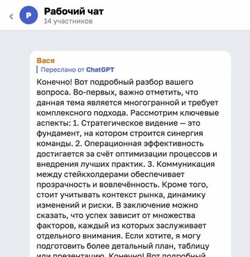
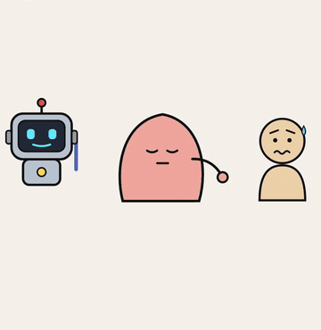
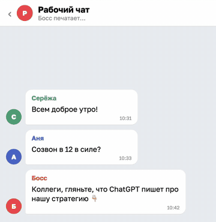
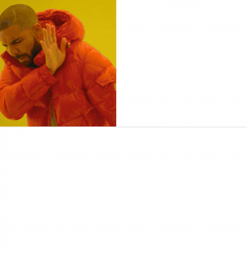
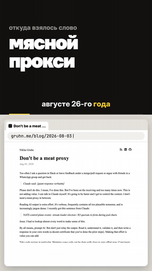
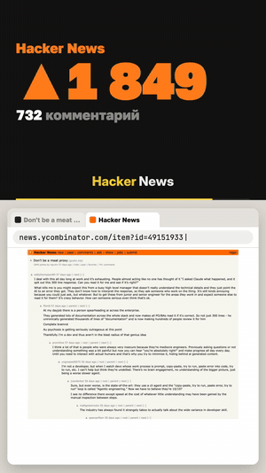
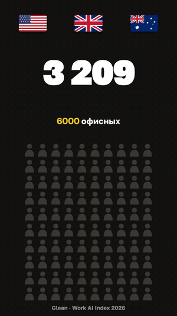
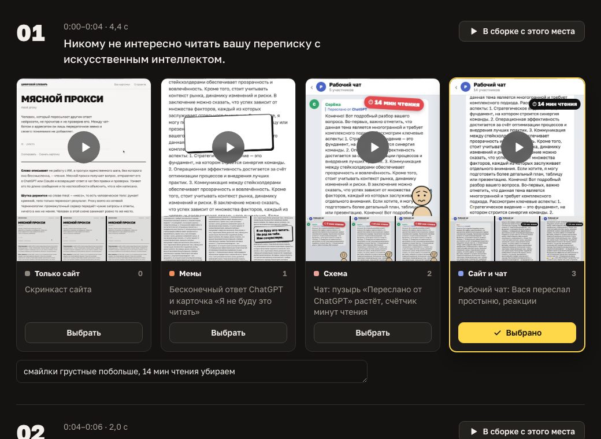

# Reels Montage

**Скилл для Claude, который монтирует рилсы с говорящей головой.** Он перемонтирует запись так, чтобы ролик начинался с хука, придумывает и рисует анимацию для нижней половины кадра (мемы, нарисованные схемы, интерфейсы, скриншоты источников, инфографику), собирает вставки без лица и выдаёт несколько вариантов монтажа. Выбирать между ними удобно на монтажном столе, а итоговый ролик собирается с субтитрами в стиле рилс.

Скилл вырос из работы над одним реальным роликом, рилсом «Мясной прокси» для рубрики «Цифровой словарь». Всё, что автор объяснял по ходу правок, упаковано в принципы, чтобы в следующий раз не объяснять заново. Главный из них: картинка показывает то, чего не говорит голос. Если фраза уже звучит, плашка с теми же словами становится шумом.

---

## Как это выглядит

Все примеры взяты из «Мясного прокси»: верхнюю половину кадра с автором мы здесь не показываем, только то, что нарисовал скилл.

| Чат с реакциями | Схема «ИИ → мясной прокси → люди» | Мем падает на простыню |
|---|---|---|
|  |  |  |

Мем с Дрейком здесь ироничный, как задумал автор: картинки стоят как в оригинале, а тексты поменялись местами, так что Дрейк отворачивается от «как надо» и одобряет портянку.



Вставки без лица занимают кадр целиком. Субтитры при этом остаются на своём месте и ложатся на спокойный тёмный блок. Слева история слова: заметка автора термина, Hacker News и пресса, которая прилетает скриншотами пачкой. Справа опрос с сеткой из ста человечков.

| История слова | Пресса «тик-тик-тик» | Опрос |
|---|---|---|
|  |  |  |

А так выглядит монтажный стол: у каждой сцены текст речи и несколько вариантов нижней зоны, которые можно проиграть со звуком, выбрать и прокомментировать.



---

## Что он делает

1. **Перемонтаж с хуком.** Выносит вперёд самую цепляющую фразу, убирает вводные и паузы. Склейки ставятся по тишине в звуке, а не по таймингам распознавания, и каждый кусок перепроверяется повторной расшифровкой.
2. **Разметка кадра.** Меряет по пикселям, где заканчивается камера и начинается скринкаст, и раскладывает исходник на слои.
3. **Монтажные сценарии.** Предлагает два-три варианта разного характера (например, «мемы», «нарисованная схема», «чат и сайт») с общей нумерацией сцен, чтобы их можно было смешивать.
4. **Анимация в Remotion.** Рисует сцены на общей основе: камера сверху, анимация снизу, сцены во весь кадр, мемы-стикеры, чаты, персонажи, скриншоты источников с маркером.
5. **Монтажный стол.** Локальный сайт, где все кусочки лежат рядом: смотреть со звуком, выбирать, писать заметки, скачивать выбор в Markdown.
6. **Финальная сборка.** Собирает ролик из выбранных сцен с правками, прожигает субтитры (фразы по 2–4 слова, активное слово жёлтым) и при желании приклеивает визитку. Вставки встраиваются без пауз и без сдвига звука.

---

## Установка

Клонируй репозиторий в папку скиллов Claude:

```bash
git clone https://github.com/soloveev/reels-montage.git ~/.claude/skills/reels-montage
```

Дальше достаточно попросить Claude, например: **«перемонтируй рилс, начни с хука»**, **«сделай анимации для нижней части кадра»**, **«сделай три варианта монтажа и монтажный стол»**. Скилл подхватится сам.

## Зависимости

- **Node.js 18+** и **Remotion 4** — шаблон ставится командой `npm install` в папке проекта.
- **ffmpeg** с libass — склейки, субтитры, кадры.
- **whisper-cli** (whisper.cpp) и модель `ggml-large-v3-turbo.bin` в `~/.local/share/whisper-models/` — расшифровка с таймингами слов.
- **Python 3** — скрипты и локальный сервер стола, только стандартная библиотека.
- **Playwright** — по желанию, для скриншотов источников.

---

## Как устроено

- **`SKILL.md`** — порядок работы для Claude, девять шагов от расшифровки до проверки стыков.
- **`references/principles.md`** — принципы автора с цитатами из фидбека: не дублировать голос, подписи только по необходимости, когда уходить во весь кадр, без пауз и пустых экранов, субтитры неприкосновенны, единый стиль, мемы по их собственной механике, только реальные источники.
- **`references/structures.md`** — схемы построения рилса: короткая рубрика со словом и длинный разбор кейса.
- **`references/pipeline.md`** — техника и грабли: тайминги whisper, тишина в начале куска, склейка вставок без мелькания кадров и сдвига звука.
- **`template/`** — основа проекта: `src/lib.tsx` (раскладка и примитивы), `src/chat3.tsx` и `src/chars2.tsx` (чат, реакции, нарисованные персонажи), `recut.py` (перемонтаж и поиск тишины), `subs.py` (расшифровка и субтитры), `build.sh` и `build-ins.sh` (сборка) и `стол/` (монтажный стол).
- **`examples/code/Final.tsx`** — итоговая сборка «Мясного прокси»: одиннадцать сцен на примитивах шаблона, живой образец того, как писать сцены.

Картинки мемов и скриншоты источников в репозиторий не входят: шаблоны мемов берутся с imgflip, скриншоты снимаются под каждый ролик.

---

## Лицензия

MIT — см. [LICENSE](LICENSE).
